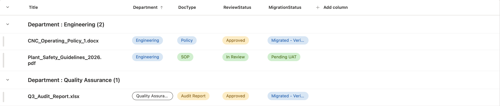

# SharePoint Migration & QA Validation Suite

An end-to-end audit, migration reconciliation, and quality assurance framework simulating the transition of departmental records from legacy systems to modern SharePoint Online / Microsoft 365.

## 1. Modern Architecture & Metadata Hub

### Source-to-Target Architecture Mapping

| Legacy SP 2013 Component | Legacy Architecture Defect | Modern Target Structure | Modern Target Configuration |
| :--- | :--- | :--- | :--- |
| `/sites/ops/eng/subsite1/shared docs/2024/SOPs/` | 6-level nested folders; character limit breaches | **Operations Hub** (Documents / Lists) | Flattened hierarchy; 0 folders; dynamic views grouped by `Department` and `DocType` |
| Classic Wiki Pages & Static Navigation | Deprecated layout tables; non-responsive UI | **Modern Site Framework** | Quick Links and structured metadata navigation |
| Classic Discussion & Custom Issues List | Deprecated HTML markup | **Microsoft Lists** | Formatted status pills and automated tracking views |
| Unique Item-Level Permissions | Broken inheritance scopes; security sprawl | **Standard 3-Tier Security Groups** | Library-level inheritance via Owners, Members, and Visitors |

### Metadata Schema Design

| Column Name | Field Type | Required | Configured Values | Functional Purpose |
| :--- | :--- | :--- | :--- | :--- |
| `Department` | Choice | Yes | `Engineering`, `Quality Assurance`, `Logistics`, `HR` | Primary categorization and grouped default view |
| `DocType` | Choice | Yes | `Policy`, `SOP`, `Audit Report`, `Template` | Dynamic filtering for departmental audits |
| `ReviewStatus` | Choice | Yes | `Draft`, `In Review`, `Approved`, `Archived` | Enforces approval workflows; filters non-approved drafts |
| `MigrationStatus` | Choice | Yes | `Migrated - Verified`, `Pending UAT`, `Flagged` | UAT tracking and defect remediation lifecycle |

---

## 2. Automated Pre-Flight & Reconciliation Engine (`migration_validator.py`)
The Python automation engine:
1. **Pre-Flight Source Audit:** Traverses directory structures, detects ROT (redundant, obsolete, and zero-byte files), flags prohibited characters (`#`, `%`, `&`), and computes MD5 checksums.
2. **ROT Remediation:** Auto-sanitizes target file names and generates the source manifest (`1_source_inventory_audit.csv`).
3. **Target Reconciliation:** Ingests post-migration target metadata exports and verifies 100% file transfer completion, byte-count parity, and metadata population (`2_post_migration_reconciliation.csv`).

---

## 3. Role-Based Access Control (RBAC) & UAT Matrix

### Security & Permission Verification

| Security Group | Permission Level | Site Navigation | Standard Document Repository | Confidential Audits Repository | Status |
| :--- | :--- | :--- | :--- | :--- | :--- |
| **Site Admin** | Full Control | Full Control | Full Control | Full Control | **PASS** |
| **Site Owner** | Full Control / Owner | Edit & Publish | Create, Edit, Delete, Approve | Manage Permissions & Files | **PASS** |
| **Department Member**| Edit / Member | Read Only | Create, Edit, Upload | Restricted (Hidden from Search) | **PASS** |
| **General Viewer** | Read / Visitor | Read Only | Read & Download Only | Restricted (Access Denied) | **PASS** |

### User Acceptance Testing (UAT) Execution Log

| Test ID | Scenario | Verification Steps | Expected Result | Actual Result | Status |
| :--- | :--- | :--- | :--- | :--- | :--- |
| **UAT-01** | Item Count & Parity | Check item counts against `1_source_inventory_audit.csv` | Exactly 142 approved files migrated; checksums match | 142 items verified | **PASS** |
| **UAT-02** | Metadata Views | Filter repository by `ReviewStatus = Approved` | Draft items hidden; grouped by Department cleanly | Correct views rendered | **PASS** |
| **UAT-03** | Restricted Protection | Attempt direct URL access via Visitor test account | HTTP 403 / "Access Required" screen triggered | Direct access blocked | **PASS** |
| **UAT-04** | Hyperlink Integrity | Scan modern pages for legacy `sp2013.local` references | Zero legacy absolute URLs present in links | 2 hardcoded links found | **FAIL (DEF-001)** |